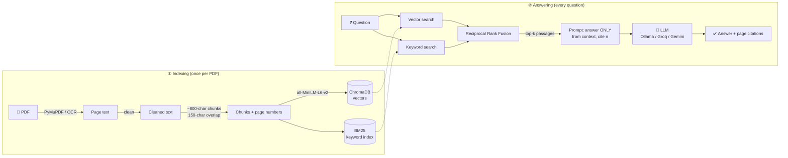

<div align="center">

# 📄 PDF RAG Chat

**Chat with your PDFs, with answers grounded in the document and page-level citations. 100% free to run.**

Upload a textbook, research paper or company policy and ask questions in plain language.
Instead of guessing from general knowledge, the app finds the relevant passages in *your* document,
answers from them, and shows you exactly where each answer came from.


[Live demo](#) · [Features](#-features) · [Quick start](#-quick-start) · [How it works](#-how-it-works) · [Evaluation](#-evaluation)

</div>

---

## 📑 Table of contents
- [Why this project](#-why-this-project)
- [Features](#-features)
- [How it works](#-how-it-works)
- [Tech stack](#-tech-stack)
- [Quick start](#-quick-start)
- [Usage](#-usage)
- [Configuration](#%EF%B8%8F-configuration)
- [Evaluation](#-evaluation)
- [Deployment](#%EF%B8%8F-deployment)
- [Project structure](#-project-structure)
- [Design decisions](#-design-decisions)
- [Limitations](#%EF%B8%8F-limitations)
- [Roadmap](#%EF%B8%8F-roadmap)
- [Contributing](#-contributing)
- [License](#-license)

---

## 💡 Why this project

Large language models don't know your private documents, and they sometimes make things up.
**Retrieval-Augmented Generation (RAG)** fixes both: before answering, the app *retrieves* the most
relevant passages from your PDFs and gives them to the model, which is instructed to answer **only**
from that context and to cite it.

The whole pipeline is written **from scratch, without LangChain or LlamaIndex**, so every step
(parsing, cleaning, chunking, embedding, retrieval, prompting) is visible and easy to experiment with.

## ✨ Features

| | Feature | Details |
|---|---|---|
| 📌 | **Page-level citations** | Answers cite passages inline, e.g. `[2]`. The sources panel shows the exact text used. |
| 🖍️ | **Highlighted source pages** | Open any cited page and see the passage highlighted directly on the PDF. |
| 🔎 | **Hybrid search** | Semantic embeddings + BM25 keyword search, merged with Reciprocal Rank Fusion. Finds both *meaning* and exact names, codes and terms (e.g. `IT-4471`). |
| 📚 | **Multiple PDFs** | Index many documents, choose which ones to search, and remove them. The index persists on disk. |
| 💬 | **Chat history** | Follow-up questions like *"what about contractors?"* use the previous question for context. |
| 🧹 | **PDF cleaning** | Strips repeated headers/footers and page numbers, re-joins hyphenated words, unwraps hard line breaks. |
| 🖨️ | **OCR for scanned PDFs** | Pages without a text layer are OCR'd with Tesseract (optional). |
| 🆓 | **Free LLMs only** | Run fully local with **Ollama**, or use the free tiers of **Groq** or **Google Gemini**. Switch in the sidebar. |
| 🚫 | **Hallucination guardrails** | Strict "answer only from context" prompt; says *"I couldn't find that in the uploaded documents"* when the answer isn't there. |
| 📊 | **Built-in evaluation** | Measures retrieval quality (hit@k, MRR) on your own question set, comparing vector-only vs hybrid. |
| ♻️ | **Deduplication** | Re-uploading the same file is detected by content hash and skipped. |

## 🧠 How it works

The app runs in two phases.



1. **Load:** text is extracted page by page with PyMuPDF, keeping page numbers for citations. Scanned pages fall back to OCR.
2. **Clean:** lines repeated on most pages (headers/footers) and page numbers are removed; broken lines and hyphenation are fixed.
3. **Chunk:** each page is split on sentence boundaries into ~800-character chunks with 150 characters of overlap, so ideas aren't cut in half.
4. **Embed and store:** chunks are embedded locally with `sentence-transformers` and stored in ChromaDB; a BM25 index is built alongside.
5. **Retrieve:** the question is searched both semantically and by keyword; the two rankings are merged with RRF.
6. **Generate:** the top passages are numbered and sent to the LLM with strict grounding instructions; the answer streams back with citations.

## 🛠 Tech stack

| Layer | Tool |
|---|---|
| Language | Python 3.10+ |
| UI | [Streamlit](https://streamlit.io) |
| PDF parsing | [PyMuPDF](https://pymupdf.readthedocs.io) (+ Tesseract OCR, optional) |
| Embeddings | [sentence-transformers](https://www.sbert.net) `all-MiniLM-L6-v2` (runs locally, free) |
| Vector database | [ChromaDB](https://www.trychroma.com) (persistent, local) |
| Keyword search | [rank-bm25](https://github.com/dorianbrown/rank_bm25) |
| LLM | [Ollama](https://ollama.com) (local) · [Groq](https://console.groq.com) (free tier) · [Google Gemini](https://aistudio.google.com) (free tier) |

## 🚀 Quick start

### Prerequisites
- Python **3.10+**
- *Either* [Ollama](https://ollama.com/download) installed locally, *or* a free [Groq](https://console.groq.com/keys) / [Gemini](https://aistudio.google.com/apikey) API key
- *(Optional)* [Tesseract](https://tesseract-ocr.github.io/tessdoc/Installation.html) for scanned PDFs

### 1. Clone and install
```bash
git clone https://github.com/<your-username>/pdf-rag-chat.git
cd pdf-rag-chat
python -m venv .venv
source .venv/bin/activate          # Windows: .venv\Scripts\activate
pip install -r requirements.txt
```

### 2. Choose a free LLM

<details open>
<summary><b>Option A: Ollama (local, private, unlimited)</b></summary>

```bash
# after installing Ollama from https://ollama.com/download
ollama pull llama3.2
```
That's it: when Ollama is running, the app selects it automatically.
`llama3.2` (3B) runs on most laptops; with 16 GB+ RAM, `qwen2.5:7b` or `llama3.1:8b` give better answers.
</details>

<details>
<summary><b>Option B: Groq or Gemini (free cloud APIs, faster, bigger models)</b></summary>

Get a free key (no credit card): [Groq](https://console.groq.com/keys) or [Gemini](https://aistudio.google.com/apikey).
Paste it into the sidebar when the app starts, or set it as an environment variable:

```bash
# macOS / Linux
export GROQ_API_KEY="gsk_..."
export GEMINI_API_KEY="..."
```
```powershell
# Windows (PowerShell)
$env:GROQ_API_KEY="gsk_..."
$env:GEMINI_API_KEY="..."
```
</details>

| | Ollama | Groq / Gemini |
|---|---|---|
| API key | Not needed | Free key |
| Usage limits | None | Free-tier rate limits |
| Privacy | PDFs never leave your machine | Retrieved passages are sent to the provider |
| Speed / quality | Depends on your hardware | Large models, very fast |
| Works when deployed online | ❌ | ✅ |

### 3. Run
```bash
streamlit run app.py
```
Open http://localhost:8501. The embedding model (~90 MB) downloads on first run; after that, indexing works offline.

## 📖 Usage

1. **Upload** one or more PDFs in the sidebar and click **Index uploaded files**.
2. **Ask** a question in the chat box, e.g. *"How many days of annual leave do employees get?"*
3. **Check the sources:** expand **📎 Sources** to see each cited passage, then toggle **Show page** to view it highlighted in the PDF.
4. **Narrow the search** by unticking documents in the sidebar, or tune *k* and hybrid search under **Settings**.

> 💡 Try it with the bundled sample: upload [`samples/handbook.pdf`](samples/handbook.pdf) and ask *"Which form do I use to request equipment?"*

## ⚙️ Configuration

**Environment variables**

| Variable | Purpose | Default |
|---|---|---|
| `GROQ_API_KEY` | Groq free-tier key (can also be pasted in the UI) | none |
| `GEMINI_API_KEY` | Google Gemini free-tier key (can also be pasted in the UI) | none |
| `OLLAMA_HOST` | Address of the Ollama server | `http://localhost:11434` |

**Pipeline settings** (top of [`rag_core.py`](rag_core.py))

| Setting | Default | Notes |
|---|---|---|
| `CHUNK_SIZE` | `800` chars | The most impactful knob. Too small loses context; too large makes retrieval fuzzy. |
| `CHUNK_OVERLAP` | `150` chars | Keeps sentences that straddle a boundary retrievable. |
| `EMBED_MODEL` | `all-MiniLM-L6-v2` | Try `BAAI/bge-small-en-v1.5` or `all-mpnet-base-v2`. |

> ⚠️ After changing chunking or the embedding model, delete the `data/` folder and re-index your PDFs.

**In-app settings:** LLM provider and model, number of passages retrieved (*k*), and hybrid search on/off.

## 📊 Evaluation

Changes to chunking, embeddings or *k* should be **measured**, not guessed. Write a small set of
real questions along with the page that answers each:

```json
[
  {"question": "How many days of annual leave do I get?", "pdf": "handbook.pdf", "pages": [1]},
  {"question": "Which form do I use to request equipment?", "pdf": "handbook.pdf", "pages": [2]}
]
```

Index the PDFs in the app, then run:

```bash
python evaluate.py samples/eval_set.json --k 5
```

It prints hit@k and MRR for vector-only and hybrid search:

- **hit@k:** share of questions where a correct page appears in the top *k* passages.
- **MRR (Mean Reciprocal Rank):** how high the first correct passage ranks (1.0 = always first).

<!-- Fill this in with your own results; it makes a great portfolio talking point. -->
| Experiment | hit@5 | MRR |
|---|---|---|
| Vector only, 800-char chunks | – | – |
| Hybrid, 800-char chunks | – | – |
| Hybrid, 500-char chunks | – | – |

## ☁️ Deployment

Deploy for free on **Streamlit Community Cloud** or **Hugging Face Spaces** using the Groq/Gemini free tiers
(Ollama can't run on these hosts).

**Streamlit Community Cloud**
1. Push this repo to GitHub.
2. Go to [share.streamlit.io](https://share.streamlit.io) → **New app** → select the repo and `app.py`.
3. Under **Advanced settings → Secrets**, add:
   ```toml
   GROQ_API_KEY = "gsk_..."
   GEMINI_API_KEY = "..."
   ```

**Hugging Face Spaces**
1. Create a new Space with the **Streamlit** SDK and push this repo to it.
2. Add `GROQ_API_KEY` / `GEMINI_API_KEY` under **Settings → Variables and secrets**.

For local secrets, copy [`.streamlit/secrets.toml.example`](.streamlit/secrets.toml.example) to `.streamlit/secrets.toml` (it's git-ignored).

> ℹ️ Free hosts have ephemeral storage, so uploaded PDFs are cleared when the app restarts.

## 📁 Project structure

```
pdf-rag-chat/
├── app.py                 # Streamlit UI: upload, chat, sources panel, settings
├── rag_core.py            # The full RAG pipeline: load → clean → chunk → embed → retrieve → generate
├── evaluate.py            # Retrieval evaluation (hit@k, MRR), vector vs hybrid
├── requirements.txt
├── LICENSE
├── samples/
│   ├── handbook.pdf       # Small sample document
│   └── eval_set.json      # Sample evaluation questions
├── docs/                  # Demo GIF and screenshots for this README
├── .streamlit/
│   └── secrets.toml.example
└── data/                  # Created at runtime (git-ignored): ChromaDB index + stored PDFs
```

## 🧩 Design decisions

- **No framework.** Building without LangChain/LlamaIndex keeps the pipeline transparent and makes each step easy to swap out or measure.
- **Chunk per page.** Chunks never cross page boundaries, so every citation points to exactly one page.
- **Sentence-aware chunking with overlap.** Splits on sentence boundaries rather than fixed offsets, so passages read naturally.
- **Hybrid retrieval with RRF.** Embeddings miss exact identifiers; BM25 misses paraphrases. Reciprocal Rank Fusion combines both rankings without needing to tune score weights.
- **Header/footer removal.** Boilerplate repeated on every page pollutes embeddings and wastes context, so it's detected statistically and dropped.
- **Low temperature + strict prompt.** The model is told to use only the numbered passages, cite them, and admit when the answer isn't present.
- **No vendor SDKs.** All three LLMs are called over plain HTTP with `requests`, and nothing requires a paid account.

## ⚠️ Limitations

- Tables, multi-column layouts and figures may be extracted imperfectly; text inside images is only read via OCR.
- Small local models (≈3B parameters) follow the grounding instructions less reliably than larger ones.
- Follow-up handling is a simple heuristic (it adds the previous question to the search), not LLM query rewriting.
- Free API tiers have rate limits; switch providers in the sidebar if you hit one.

## 🗺️ Roadmap

- [ ] Table extraction (e.g. `pdfplumber` / `camelot`) and image captioning
- [ ] Re-ranking retrieved passages with a cross-encoder
- [ ] LLM-based query rewriting for follow-up questions
- [ ] Answer-quality evaluation (faithfulness / correctness), not just retrieval
- [ ] Docker image for one-command setup

## 🤝 Contributing

Contributions, issues and feature requests are welcome!

1. Fork the repo and create a branch: `git checkout -b feature/my-feature`
2. Commit your changes: `git commit -m "Add my feature"`
3. Push and open a pull request.

If you change retrieval or chunking, please include before/after numbers from `evaluate.py`.

## 📜 License

Distributed under the MIT License. See [`LICENSE`](LICENSE) for details.

## 🙏 Acknowledgements

[Sentence-Transformers](https://www.sbert.net) · [ChromaDB](https://www.trychroma.com) · [PyMuPDF](https://pymupdf.readthedocs.io) · [Streamlit](https://streamlit.io) · [Ollama](https://ollama.com) · [Groq](https://groq.com) · [Google AI Studio](https://aistudio.google.com)

---

<div align="center">

Built by **[Your Name](https://github.com/<your-username>)**. If this project helped you, consider giving it a ⭐

</div>
